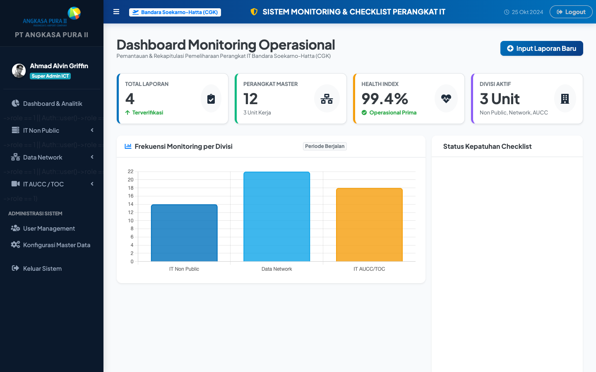
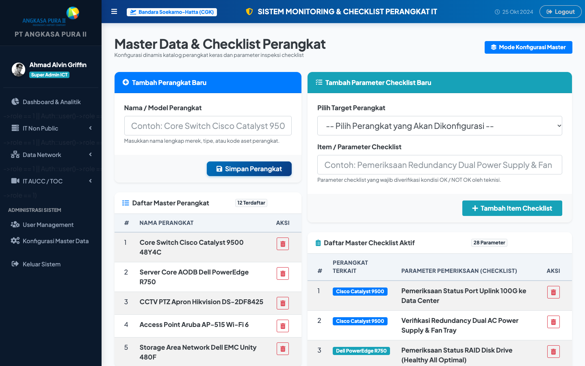
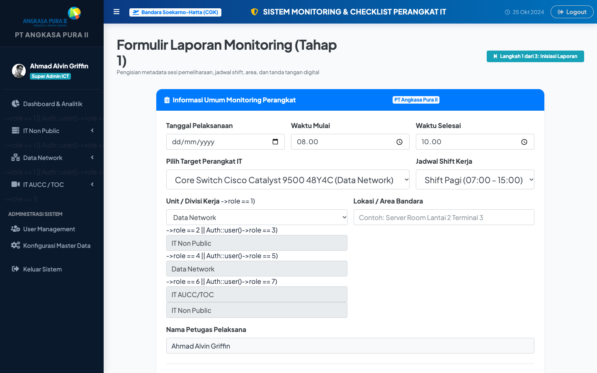
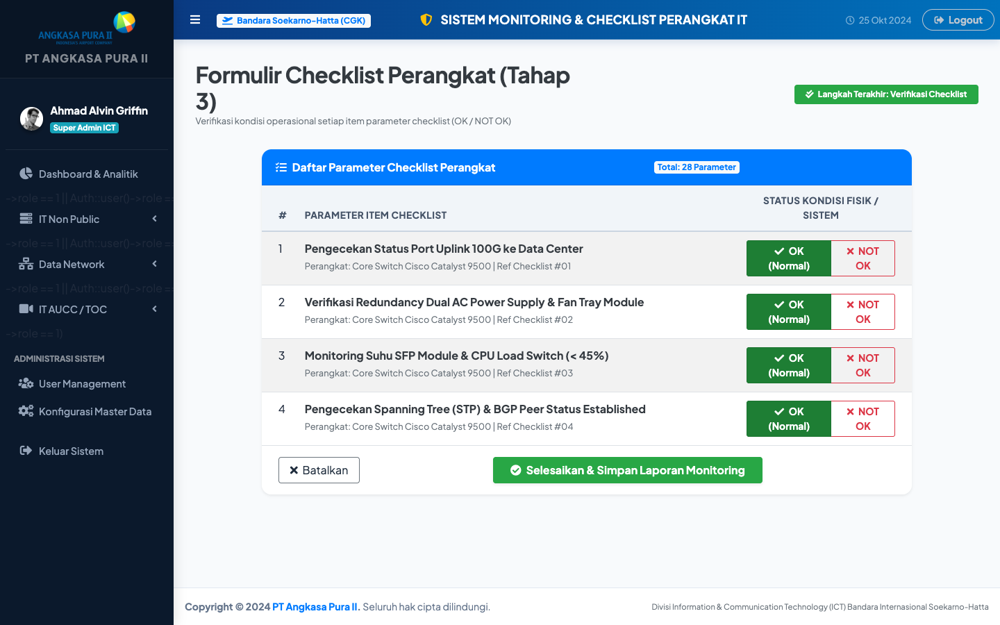
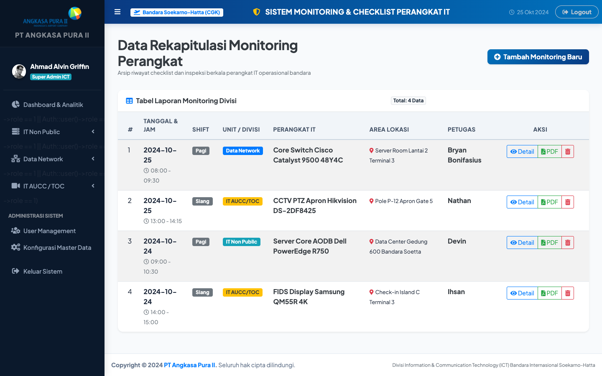
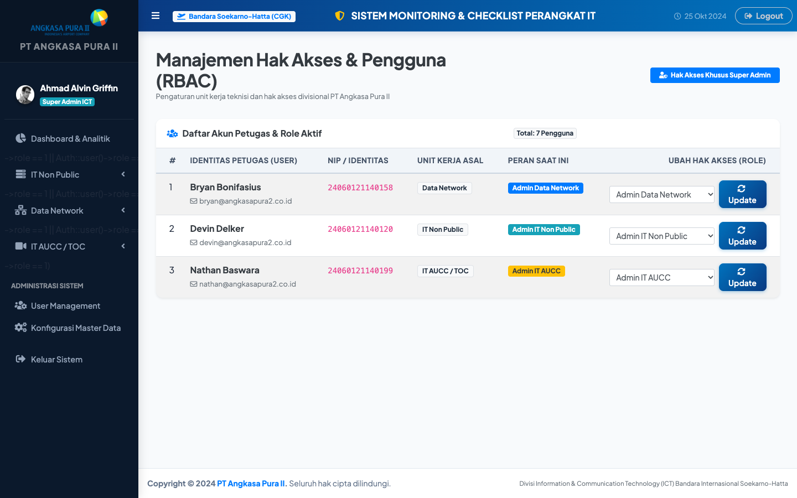
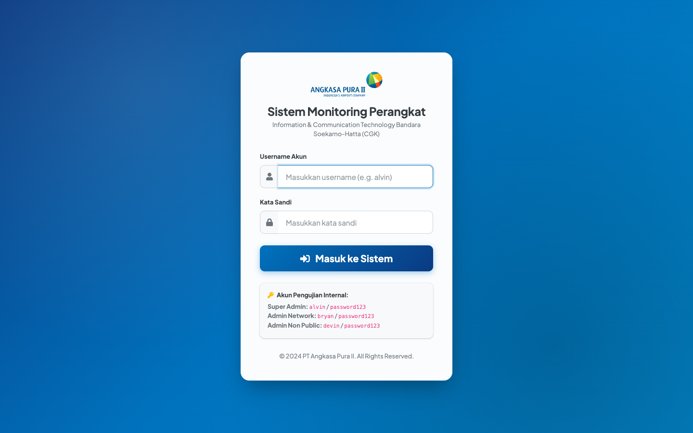

# ✈️ Sistem Monitoring Perangkat & Dynamic Form - PT Angkasa Pura II

<p align="center">
  
  
  
  
  
  
</p>

---

## 📌 Ringkasan Proyek

**Sistem Monitoring Perangkat (Dynamic Form AP2)** adalah aplikasi web *enterprise monitoring* yang dikembangkan untuk mendukung pemeliharaan berkala dan inspeksi operasional perangkat IT di lingkungan **PT Angkasa Pura II**. 

Sistem ini memiliki keunggulan berupa **Dynamic Form & Checklist Builder**, di mana administrator dapat menambah, mengubah, atau menghapus item checklist inspeksi secara dinamis tanpa perlu mengubah struktur basis data atau kode sumber. Teknisi lapangan dapat melakukan checklist kondisi perangkat (*OK / Not OK*), melampirkan catatan temuan, mengunggah foto dokumentasi fisik, dan mencetak laporan monitoring resmi dalam format **PDF**.

---

## 📸 Dokumentasi Antarmuka (Screenshots)

### 📊 Tampilan Sistem Monitoring Enterprise AP2
| 1. Dashboard Eksekutif & Analitik KPI | 2. Master Perangkat & Dynamic Checklist |
| :---: | :---: |
|  |  |
| *Ringkasan statistik metrik, compliance donut chart, & monitoring terkini* | *Konfigurasi perangkat bandara & dynamic checklist item builder* |

| 3. Form Laporan Monitoring & Dual Signature | 4. Form Checklist Kondisi Perangkat |
| :---: | :---: |
|  |  |
| *Input divisi bandara, teknisi, supervisor, dan digital signature pad* | *Inspeksi indikator teknis OK / NOT OK, catatan temuan, & upload foto* |

| 5. Rekapitulasi Data Monitoring Divisi | 6. Manajemen Role & Pengguna |
| :---: | :---: |
|  |  |
| *Daftar inspeksi berkala per unit bandara dengan status verifikasi & export PDF* | *Administrasi pengguna internal, kontrol akses role admin & teknisi* |

<p align="center">
  <b>7. Antarmuka Login Enterprise Angkasa Pura II</b><br/>
  
</p>

---

## ✨ Fitur-Fitur Utama

- 🛠️ **Dynamic Checklist Builder:** Tambah baris parameter checklist untuk setiap perangkat secara instan menggunakan JavaScript dynamic DOM form.
- 🏢 **Multi-Division Asset Categorization:** Pengelompokan pemeliharaan perangkat berdasarkan unit operasional:
  - **IT Non-Public** (Infrastruktur server & workstation internal).
  - **Data Network** (Switch, Router, Access Point, Rack Server).
  - **IT AUCC / TOC** (Terminal Operation Center & Airport Unified Control Center).
- 📷 **Inspection Evidence & Photo Upload:** Unggah foto dokumentasi kondisi fisik perangkat sebagai bukti verifikasi inspeksi.
- 📄 **Automated PDF Export (DomPDF):** Generate dokumen rekapitulasi monitoring perangkat secara otomatis siap cetak dan tanda tangan.
- 📈 **Interactive Analytical Dashboard (Chart.js):** Grafik status operasional perangkat dan metrik kepatuhan checklist harian.
- 👥 **User Role Management:** Pengaturan hak akses peran (*Administrator* dan *Staff Teknisi/Operator*).

---

## 🛠️ Tech Stack & Dependencies

| Lapisan | Teknologi | Deskripsi / Peran |
| :--- | :--- | :--- |
| **Backend Framework** | [Laravel 10](https://laravel.com/) | Framework PHP modern dengan arsitektur MVC dan Eloquent ORM |
| **Bahasa Pemrograman**| [PHP 8.2+](https://www.php.net/) | Bahasa server-side dengan strict typing |
| **Database** | [MySQL](https://www.mysql.com/) | Penyimpanan relasional master perangkat, checklist, dan log monitoring |
| **Admin Template** | [AdminLTE 3](https://adminlte.io/) | Dashboard responsif dengan navigasi hierarkis |
| **PDF Engine** | [barryvdh/laravel-dompdf](https://github.com/barryvdh/laravel-dompdf) | Render HTML template ke format PDF resolusi cetak |
| **Data Visualization**| [Chart.js](https://www.chartjs.org/) | Diagram analitik kondisi perangkat |
| **Frontend Utilities** | jQuery, Bootstrap 5 | Interaktivitas dynamic row form dan modal dialog |

---

## 📂 Struktur Direktori Proyek

```text
Dynamic-Form-Laporan-Monitoring-AP2/
├── app/
│   ├── Http/Controllers/
│   │   ├── AuthController.php                   # Autentikasi & manajemen role pengguna
│   │   ├── MasterperangkatController.php        # CRUD master perangkat & builder checklist dinamis
│   │   ├── LaporanMonitoringController.php       # Manajemen laporan, filter divisi & export PDF
│   │   ├── MonitoringPerangkatController.php     # Form checklist perangkat teknisi
│   │   ├── MonitoringChecklistController.php     # Verifikasi dan validasi item checklist
│   │   └── ChartJSController.php                # Agregasi data grafik dashboard
│   └── Models/                                  # Eloquent Models (Masterperangkat, LaporanMonitoring, dll.)
├── database/
│   └── migrations/                              # Skema tabel database monitoring
├── public/
│   ├── dist/                                    # Asset AdminLTE & logo Angkasa Pura II
│   ├── file/                                    # Direktori penyimpanan upload gambar bukti monitoring
│   └── Tampilan-Website/                        # Dokumentasi visual antarmuka sistem
├── resources/
│   └── views/
│       ├── auth/                                # Layar login & registrasi
│       ├── masterperangkat/                     # Halaman konfigurasi dinamis master data
│       ├── formuser/                            # Halaman pengisian form checklist teknisi
│       └── generatepdf.blade.php                # Template laporan cetak resmi PDF
├── routes/
│   └── web.php                                  # Routing sistem monitoring AP2
└── screenshots/                                 # Tangkapan layar beresolusi tinggi untuk dokumentasi
```

---

## 🚀 Panduan Instalasi & Menjalankan Aplikasi

### 1. Prasyarat Sistem
- **PHP** versi `>= 8.2` (dengan ekstensi `pdo_mysql`, `gd`, `fileinfo`, `mbstring`)
- **Composer** ([Panduan Unduh Composer](https://getcomposer.org/))
- **MySQL Database Server** (XAMPP / Laragon / MySQL Server)
- **Node.js** & **npm** (opsional untuk bundling asset)

### 2. Clone Repository
```bash
git clone git@github.com:ahmadalvin92/Dynamic-Form-Laporan-Monitoring-AP2.git
cd Dynamic-Form-Laporan-Monitoring-AP2
```

### 3. Instalasi Dependensi Composer
```bash
composer install
```

### 4. Konfigurasi Lingkungan (.env)
Salin berkas konfigurasi template:
```bash
cp .env.example .env
```
Sesuaikan konfigurasi koneksi database pada berkas `.env`:
```dotenv
APP_NAME="Monitoring AP2"
APP_ENV=local
APP_KEY=
APP_DEBUG=true
APP_URL=http://localhost:8000

DB_CONNECTION=mysql
DB_HOST=127.0.0.1
DB_PORT=3306
DB_DATABASE=monitoring_ap2
DB_USERNAME=root
DB_PASSWORD=
```

### 5. Generate Application Key & Symlink Storage
```bash
# Generate enkripsi security key
php artisan key:generate

# Buat symbolic link direktori publik untuk file upload bukti gambar
php artisan storage:link
```

### 6. Migrasi Database & Seeding Data Realistis Bandara
Pastikan database `monitoring_ap2` telah dibuat di MySQL, lalu jalankan migrasi dan seeder data perangkat bandara (Cisco Catalyst, Dell PowerEdge AODB, Hikvision PTZ Apron CCTV, Aruba AP, dll):
```bash
# Jalankan migrasi tabel
php artisan migrate

# Jalankan seeder perangkat & checklist operasional Angkasa Pura II
php artisan db:seed --class=AirportMasterDataSeeder
```

### 7. Jalankan Server Aplikasi
```bash
php artisan serve
```
Akses aplikasi melalui peramban di: **`http://127.0.0.1:8000`**
- **Default Admin Account:** `alvin@angkasapura2.co.id` / `password123` (Role: 1 - Administrator)
- **Default Technician Account:** `teknisi@angkasapura2.co.id` / `password123` (Role: 2 - Teknisi Lapangan)

---

## 👨‍💻 Developer & Author

**Ahmad Alvin Griffin**
- GitHub: [@ahmadalvin92](https://github.com/ahmadalvin92)
- Email: ahmadalvin92@gmail.com
- Organisasi Mitra: PT Angkasa Pura II (AP2)
